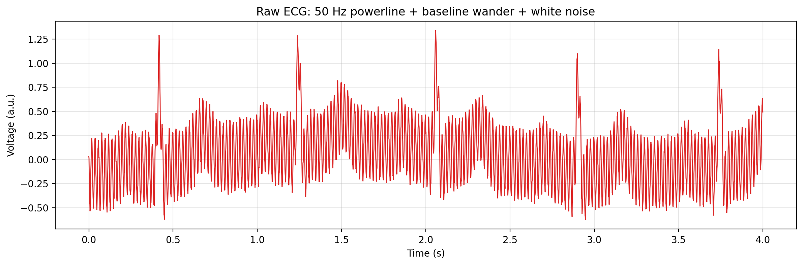
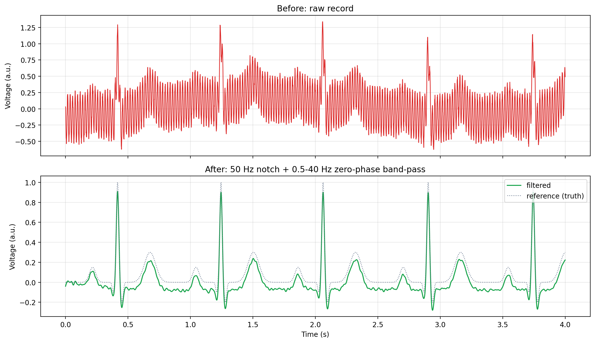
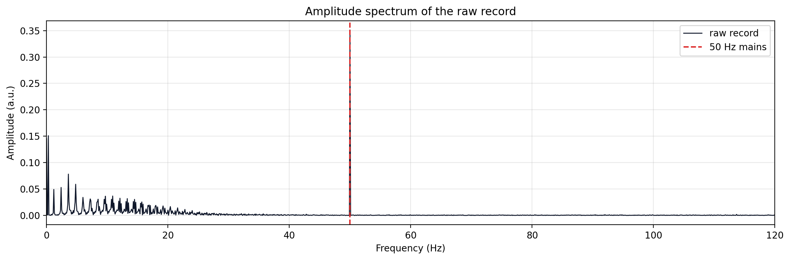
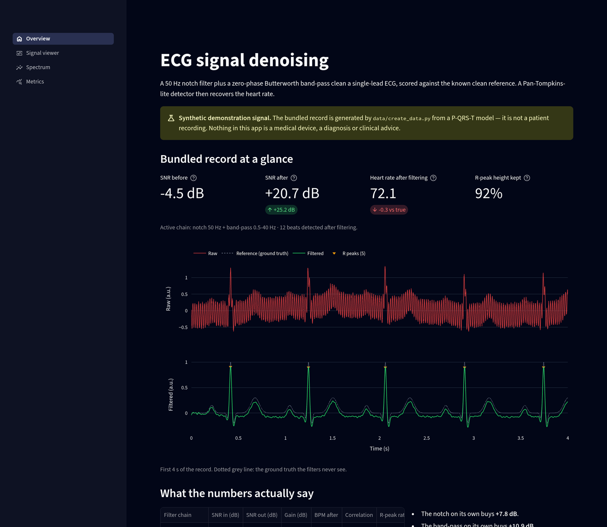
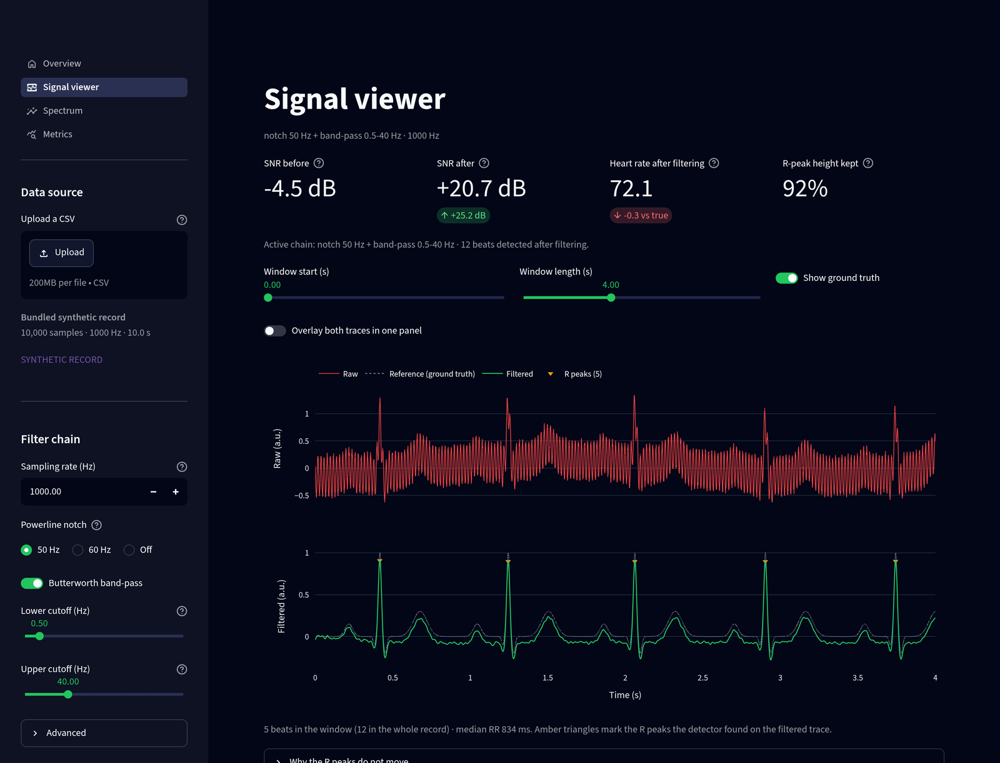
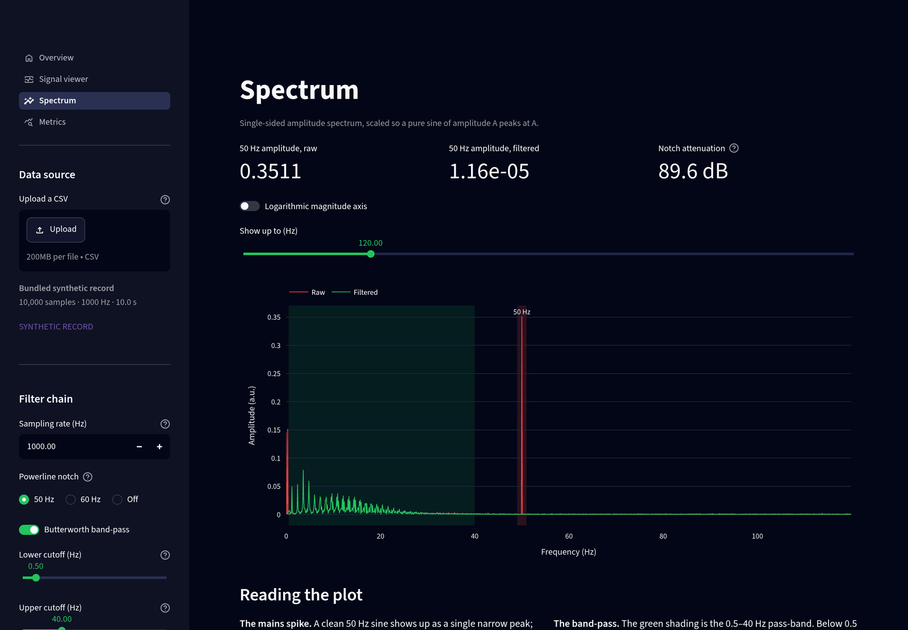

# ECG Signal Denoising

A single-lead ECG is cleaned with a **50 Hz notch filter** and a **zero-phase Butterworth band-pass**,
then scored against the known clean reference. A **Pan-Tompkins-lite QRS detector** recovers the heart
rate from the result. A Streamlit app shows all of it live.

> **This is not machine learning and not a medical device.** The "model" is a deterministic DSP chain.
> The bundled ECG is **synthetic** — generated from a P-QRS-T model, no patient data — and nothing here
> is a diagnosis or clinical advice.

## Results on the bundled record

| Filter chain | SNR in (dB) | SNR out (dB) | Gain (dB) | BPM after |
| :----------- | ----------: | -----------: | --------: | --------: |
| raw (no filter) | −4.50 | −4.50 | 0.00 | 72.1 |
| notch 50 Hz only | −4.50 | +3.31 | +7.81 | 72.1 |
| band-pass 0.5–40 Hz only | −4.50 | +6.38 | +10.88 | 72.1 |
| **notch + band-pass** | −4.50 | **+20.68** | **+25.18** | **72.1** |

SNR is `10·log10(var(reference) / var(reference − estimate))` against the clean reference.

**Heart rate:** 72.1 bpm detected from the filtered signal, against 72.4 bpm used to generate the
record — an absolute error of **0.25 bpm**.

**The honest finding.** Neither filter is enough on its own. A 40 Hz low-pass attenuates the 50 Hz
spike by 17 dB — real, but not enough — and a notch does nothing about baseline wander. So each buys
at most ~11 dB of SNR while the pair buys ~25 dB. The price of that is visible in the morphology: the
R peak comes out **7.6 % shorter** and the trace still correlates **0.996** with the ground truth. The
filter is not free.

| Before | After |
| :----: | :---: |
|  |  |
| 50 Hz hum, baseline wander, white noise | Filtered (green) against the truth (dotted) |



## Quick start

```bash
python -m venv .venv
.venv/bin/pip install -r requirements.txt

.venv/bin/python data/create_data.py     # regenerate the synthetic record
.venv/bin/python src/fft_denoising.py    # score every chain -> data/process/metrics.csv
.venv/bin/python -m streamlit run app/Home.py
```

On this machine Streamlit lives in the user site-packages, so `.venv/bin/streamlit` does not exist —
use `.venv/bin/python -m streamlit run app/Home.py`.

## The app

Four pages, built with `st.navigation` / `st.Page` (Streamlit 1.66):

- **Overview** — headline SNR/BPM numbers, the four-chain comparison table, limitations.
- **Signal viewer** — raw vs filtered in the time domain, detected R peaks, zoom window.
- **Spectrum** — amplitude spectrum before/after, live notch and band-pass controls.
- **Metrics** — SNR per chain, heart-rate accuracy, and what the filter costs in morphology.

Sidebar controls re-filter the selected record live: sampling rate, 50/60 Hz notch, band-pass on/off
and both cutoffs, plus the notch quality factor. Uploads must be a CSV with `time` and `voltage`
(`voltage_cleaned` is accepted as a fallback); the schema is validated and failures are shown as a
readable message, never a traceback. An uploaded file that also carries a `voltage_reference` column
gets the same SNR scoring as the bundled record.

### Overview



Headline SNR before/after, the heart rate recovered from the filtered trace, and what the filter cost
in R-peak height — followed by the raw and filtered traces on a shared time axis so the 50 Hz hum and
the recovered P-QRS-T complexes are visible side by side.

### Signal viewer



A zoomable window with the detected R peaks marked. The caption separates the beats inside the window
from the beats in the whole record, because "5" next to "12 beats detected" otherwise looks like a bug.

### Spectrum



The mains spike before and after. The 50 Hz component drops by **89.6 dB**, and the green band shows
exactly what the 0.5–40 Hz pass-band lets through. This page is the reason the notch is not optional:
a 40 Hz low-pass alone attenuates the spike by 17 dB, which is real but nowhere near enough.

## Project structure

```
data/
  create_data.py              # synthetic P-QRS-T generator (deterministic, seed 20240501)
  raw/ecg_noisy_raw.csv       # contaminated record            (time, voltage)
  process/ecg_reference_clean.csv  # ground truth              (time, voltage)
  process/clean_ecg_noisy.csv # filtered output, backwards compatible (time, voltage_cleaned)
  process/metrics.csv         # the table above, regenerated by src/fft_denoising.py
  process/ecg_metadata.json   # sampling rate, heart rate, noise parameters
src/
  fft_denoising.py            # spectrum, notch, bandpass, denoise, snr, qrs_indices, estimate_bpm
app/
  Home.py                     # entrypoint + overview page
  lib/                        # io (loading/validation), dsp (cached wrappers), charts, ui
  pages/                      # 1_Signal_Viewer, 2_Spectrum, 3_Metrics
notebooks/
  ecg_exploration.ipynb       # generates the figures in images/
images/                       # committed figures
```

## Method

1. **FFT notch** — bins within ±1 Hz of 50 Hz are attenuated with a raised-cosine taper. The original
   version of this project zeroed the bin outright, and the abrupt edge produced Gibbs ringing across
   the whole trace; the taper removes that.
2. **Band-pass** — Butterworth, order 4, 0.5–40 Hz, run through `sosfiltfilt`. Forwards-backwards
   filtering gives exactly zero phase, so R peaks keep their timing. (A one-way `lfilter` shifts them.)
3. **Scoring** — SNR, RMSE and Pearson correlation against the reference, plus the R-peak height and
   standard-deviation ratios that show what the filter cost.
4. **QRS detection** — 5–15 Hz band-pass, derivative, square, 150 ms moving-window integration, adaptive
   threshold (Pan & Tompkins SPKI/NPKI), 200 ms refractory. Heart rate is `60 / median(RR)`.

## What changed in this pass

The original notebook produced a denoised trace and three static figures. The
Streamlit app, the validation layer and every fix below were added afterwards.

| Area | Before | After |
|---|---|---|
| **Generator** | `data/create_data.py` saved the `noise_50Hz` array into the `voltage` column, so the committed "raw ECG" was a pure 50 Hz sine with no heartbeat in it | Saves the assembled P-QRS-T + wander + white-noise trace, and also writes the clean reference used for scoring |
| Notch | The 50 Hz FFT bin was zeroed outright; the abrupt edge produced Gibbs ringing across the whole trace | Raised-cosine taper over ±1 Hz — same attenuation, no ringing |
| Band-pass | The original pipeline had no time-domain band-pass at all — it only zeroed the 50 Hz FFT bins, so baseline wander and everything above the mains frequency survived | Butterworth 0.5–40 Hz through `sosfiltfilt`; forward–backward filtering has exactly zero phase, so R peaks keep their timing (a one-way `lfilter` would shift them) |
| Sampling rate | The filter used the sidebar value while the QRS detector used the file's inferred rate — two different clocks | Both read `settings.fs`; the sidebar value is clamped to the widget range instead of raising |
| Attenuation card | Showed **−89.6 dB** for an 89.6 dB drop (sign flipped at the display layer) | Shows `89.6 dB` |
| Short uploads | A 1.2 s CSV crashed the viewer: `floor(1.2 − 0.5)` made both slider bounds `0.0`, and Streamlit refuses equal `min_value`/`max_value` | The zoom controls are skipped for records under 1.5 s |
| Millisecond time column | A CSV whose `time` was in ms inferred 1 Hz and crashed the sampling-rate widget | Rate is clamped to 50–5000 Hz and the detected value is stated |
| "Back to bundled record" | Cleared the cached bytes but not the uploader's own session key, so the file came straight back | Clears the uploader key too |
| Plot legend | Legend overlapped the "Raw" subplot title and clipped "Filtered" | Panel labels moved to the y-axes; legend sits on top |

The generator bug is the one worth reading twice: the repository's committed raw
signal had no heartbeat in it, and every downstream number was therefore
measuring how well a filter removes 50 Hz from a 50 Hz sine. Re-filtering the
old CSV was what exposed it.

## Limitations

- The bundled record is synthetic: one lead, one rate (1000 Hz), one heart rate (~72 bpm), no motion
  artefact, no arrhythmia, no lead variability. The numbers are a sanity check, not a benchmark.
- The SNR is only computable because the noise was added on top of a known clean trace. On a real
  recording you would need a clean lead or expert annotations to get the same number.
- The 0.5 Hz high-pass trims the slow T wave and the 40 Hz low-pass rounds the R peak — a real
  diagnostic ECG would use a wider band and accept more noise.
